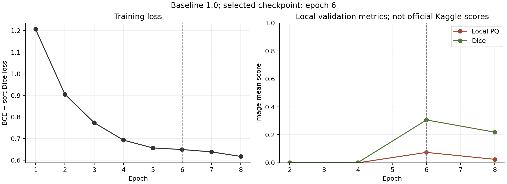
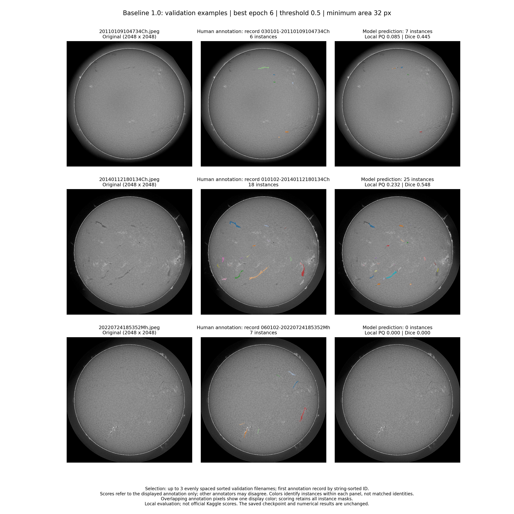

# Solar Filament Instance Segmentation

## Introduction

This CS 1675 project studies the segmentation of solar filaments in full-disk H-alpha images. The task is to identify filament pixels and separate individual structures. We have implemented and trained a U-Net baseline, evaluated it on held-out images, and produced visual comparisons with human annotations. The current work establishes an initial reference for further study; no improved model has been evaluated yet.

## Data

We use MAGFiLO images from GONG solar observations, described by [Ahmadzadeh et al. in *Scientific Data* (2024)](https://doi.org/10.1038/s41597-024-03876-y). The supplied labeled data contain 707 grayscale images at 2048 × 2048 pixels and 1,154 annotation records. An image can have one to three annotation sets, so the number of records is larger than the number of distinct images. These records must not be treated as independent input images.

The saved split contains 500 training images, 102 validation images, and 105 internal-test images. Observations from the same calendar month stay in one subset, together with all annotation records for each image. Training uses the first annotation record in sorted ID order for each image; this choice does not imply that the selected annotator is more reliable. Evaluation compares each prediction with every available record for its image. The separate images without public labels are not used as the internal test set.

## Method

Our model follows the encoder–decoder structure of [U-Net](https://lmb.informatik.uni-freiburg.de/people/ronneber/u-net/), with skip connections carrying spatial detail to the decoder. The single-channel network has four encoder levels, a base width of 16, and 1,963,809 trainable parameters. Images are normalized by dividing their intensities by 255. Each training epoch samples one 512 × 512 crop from each training image, with matched flips and 90-degree rotations applied to the image and target mask.

We trained for eight epochs using AdamW, a learning rate of 0.001, batch size 2, and BCE-with-logits plus soft Dice loss. Validation was performed every two epochs. Epoch 6 was retained because it achieved the highest validation PQ under our local evaluator. For full-image inference, non-overlapping tiles are reassembled into a foreground probability map. A threshold of 0.5, removal of connected regions smaller than 32 pixels, and eight-connected component labeling produce individual predicted filament masks. These settings are the initial baseline configuration and have not been selected through a parameter search.

## Results

The table reports the selected epoch-6 model. These are **local image-mean metrics**, not scores from an external evaluation service. For each image, scores are first averaged over its annotation records; the reported value then averages over images.

| Subset | Images | Local PQ | Dice | IoU |
| --- | ---: | ---: | ---: | ---: |
| Validation | 102 | 0.0743 | 0.3062 | 0.1945 |
| Internal test | 105 | 0.0591 | 0.3183 | 0.2051 |



The loss decreased across the eight epochs, while validation performance peaked at epoch 6 and declined at epoch 8. Training longer did not improve this validation check. This observation alone does not establish the cause of the decline.



These three validation images were selected at evenly spaced positions in sorted filename order, independently of prediction quality. Each row shows the original image, one annotation record, and predictions from the saved model. The first example has six annotated instances and seven predicted regions; the third has seven annotated instances and no predicted regions. A similar object count does not imply correct matches. Panel colors distinguish instances within that panel, and matching colors across panels do not indicate matched identities. The displayed example scores refer only to the shown annotation record, and the examples do not summarize the full validation set.

## Limitations

The current baseline has limited overlap with human labels and uneven performance across the displayed images. Binary foreground segmentation followed by connected components can separate a broken structure into several instances or join touching structures. Non-overlapping inference tiles can also create boundary artifacts. These are possible failure mechanisms to investigate, rather than measured explanations for every prediction error.

Our local PQ implementation has not yet been aligned with the reference self-evaluation program. Source inspection found differences in aggregation, instance matching, and empty-mask handling; complete real-data re-evaluation remains pending. The published numbers should therefore retain their local-evaluation label. Differences between annotators, label geometry, and possible near-duplicate observations across months have not yet been fully audited. Month grouping does not by itself prove that all related observations are separated.

## Next Steps

We will verify evaluation compatibility, review annotation differences and possible duplicate observations, and quantify prediction errors across the validation set. These checks will establish a more reliable basis for comparison. The research question, improvement method, and hypothesis for later experiments will be decided by the team after discussing the observed results.

## Reproduction

`baseline.py` contains the complete baseline implementation, `requirements.txt` lists its dependencies, and this README explains the experiment and current limitations. The two files in `results/` are the checked training curves and real prediction comparisons. These are the five repository files. Raw images, model weights, generated run outputs, and private project records are not included.

The recorded training environment used PyTorch 2.10.0+cu128, NumPy 2.0.2, Pillow 11.3.0, pycocotools 2.0.11, and SciPy 1.16.3. Matplotlib is required for figure generation; its version was not recorded, so it is intentionally unpinned. Install a CUDA-enabled PyTorch 2.10.0 build compatible with the machine before installing the remaining requirements. Full training requires a CUDA GPU; the smoke check, saved-model evaluation, and visualization can also run on CPU.

```bash
python -m pip install -r requirements.txt
python baseline.py smoke
```

The data root passed to `--data` must contain `train/train_images/` and `train/MAGFiLO_1.0_Annotations_kaggle2026_train.json`. This is the input format expected by the current code; an arbitrary download of the original dataset may require format preparation. The annotation JSON used in the recorded run has SHA-256 `5da9e92b5a1a1947fd5d57adb6688269625c48ec1ef884daf2a01618c9ed54a1`. Keep the original data and run outputs outside the repository.

The following command reproduces the recorded training configuration. It is provided for a fresh reproduction run and is not needed to view the published results. Hardware and software differences can affect the exact trained weights and scores.

```bash
python baseline.py train --data /path/to/data --out /path/to/baseline-output \
  --epochs 8 --batch-size 2 --patch 512 --width 16 --lr 0.001 \
  --seed 2026 --workers 2 --val-every 2 --threshold 0.5 --min-area 32
```

Training saves `split.json`, `history.json`, the validation-selected `baseline.pt`, and the two figures in the output directory. To evaluate and visualize an existing run, keep those saved files together and use the same data distribution. These commands reuse the saved checkpoint without training it again.

```bash
python baseline.py evaluate --data /path/to/data --out /path/to/baseline-output --split test
python baseline.py visualize --data /path/to/data --out /path/to/baseline-output
```
