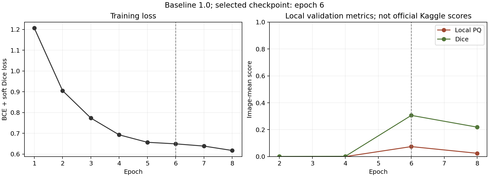

# Solar Filament Instance Segmentation

This CS 1675 project studies how to recover individual solar filaments in full-disk H-alpha images. Several dark structures that annotators traced were missed by our original U-Net. We are testing whether an input adjustment that emphasizes faint dark lines helps the network find them, and whether it helps to train on more than one annotation of the same observation. The code in [baseline.py](baseline.py) implements all five configurations in our current study. The scores and figures published below document our earlier raw-image baseline.

## Images and annotations

The labeled data contain 707 grayscale GONG observations at 2048 × 2048 pixels and 1,154 MAGFiLO annotation records. Each observation has one to three records containing instance polygons. We keep observations from the same calendar month together, giving 500 training, 102 validation and 105 held-out images. The 180 images supplied without public labels are separate. The validation set has 159 annotation records. [MAGFiLO data paper](https://doi.org/10.1038/s41597-024-03876-y)

## Model and experiments

The four-level U-Net has a base width of 16 and 1,963,809 parameters. Its decoder combines upsampled features with the corresponding encoder features. We compare three ways to form the network input. With `baseline`, the network reads normalized grayscale intensity. With `dark`, it subtracts a learned fraction of the deficit below the valid-pixel mean in a 31 × 31 neighborhood. With `direction`, this adjustment is weighted by a fixed four-orientation filter that compares a dark line with its two flanks. The two enhancements each add one shared gain, initialized to zero and constrained to [0, 2]. Both still feed a single-channel image to the network. [U-Net](https://lmb.informatik.uni-freiburg.de/people/ronneber/u-net/)

With `--labels first`, an image's target is the foreground union of its first record in string-sorted ID order. With `--labels consensus`, we form that union separately for every record and average the masks pixel by pixel. Two votes in three produce a target of 2/3. All configurations use the first record for foreground-biased crop selection, carry out the same geometric augmentation and draw one 512 × 512 patch per image per epoch. At inference the model reads only the image. Full-size probability maps are assembled from tiles, thresholded at 0.5 and split into eight-connected components of at least 32 pixels.

| Run directory | Input | Training labels |
| --- | --- | --- |
| v1.0-base | Raw grayscale | First |
| v1.1-dark | Local darkening | First |
| v1.2-line | Direction-weighted darkening | First |
| v1.2-vote | Raw grayscale | Consensus |
| v1.2-both | Direction-weighted darkening | Consensus |

Comparing v1.2-line with v1.1-dark isolates the fixed direction weighting under first-record supervision. Comparing v1.2-vote with v1.0-base, or v1.2-both with v1.2-line, isolates the training target for a fixed input. All arms use eight epochs, batch size 2, AdamW with learning rate 0.001, and BCE-with-logits plus soft Dice loss. We validate every two epochs and select the best checkpoint by local validation PQ, breaking ties with Dice. Each prediction is compared with each record independently, and scores are averaged first over records for an image, then over images. Instance diagnostics also report recall, precision and false positives for strict IoU > 0.50 and exploratory IoU ≥ 0.10. The five-arm comparison uses only the 102 validation images.

## Historical baseline results

These are local scores from the earlier raw-image, first-record U-Net. Epoch 6 gave the best validation PQ in that eight-epoch run. The 105 internal-test observations were held out from training and checkpoint selection. Results from the current five-arm study will be reported separately after verification.

| Original split | Images | Local PQ | Mask Dice | Mask IoU |
| --- | ---: | ---: | ---: | ---: |
| Validation | 102 | 0.0743 | 0.3062 | 0.1945 |
| Internal test | 105 | 0.0591 | 0.3183 | 0.2051 |




These evenly spaced examples were chosen from the sorted validation filenames before inspecting prediction quality. The third observation has seven annotated filaments and no predicted components. The displayed scores use the individual annotation record shown. Instance colors are local to each panel. Our image-mean PQ differs from pooled scoring; annotation disagreement and possible near-duplicate observations across months remain sources of uncertainty.

## Running the code

The current study runs on one RTX 5090 with PyTorch 2.8.0+cu128, NumPy 2.3.2, Pillow 11.3.0, pycocotools 2.0.11, SciPy 1.16.3 and Matplotlib 3.10.5. On a compatible Linux CUDA machine, the commands below install the recorded environment and check the three model inputs. Full training uses one NVIDIA GPU. The smoke checks, saved-checkpoint evaluation and visualization can also run on CPU. [PyTorch installation options](https://pytorch.org/get-started/previous-versions/)

The earlier baseline figures and scores were produced in an environment with PyTorch 2.10.0+cu128 and NumPy 2.0.2. Pillow, pycocotools and SciPy had the same versions listed above. The original Matplotlib version was not recorded. Reproductions on different hardware and software can yield different scores.

```sh
python -m pip install torch==2.8.0 --index-url https://download.pytorch.org/whl/cu128
python -m pip install -r requirements.txt
python baseline.py smoke --variant baseline
python baseline.py smoke --variant dark
python baseline.py smoke --variant direction
```

Use the extracted distribution containing `train/train_images/` and `train/MAGFiLO_1.0_Annotations_kaggle2026_train.json`. The training annotation file used here has SHA-256 `5da9e92b5a1a1947fd5d57adb6688269625c48ec1ef884daf2a01618c9ed54a1`. Point `DATA` at that directory. Set `RUNS` to a separate, writable directory.

```sh
set -e
DATA=/path/to/data
RUNS=/path/to/runs
run_arm() {
  python baseline.py train --data "$DATA" --out "$RUNS/$1" \
    --variant "$2" --labels "$3" --workers 2 --epochs 8 --batch-size 2 \
    --patch 512 --width 16 --lr 0.001 --seed 2026 --val-every 2 \
    --threshold 0.5 --min-area 32 --no-visualize
  python baseline.py evaluate --data "$DATA" --out "$RUNS/$1" --split val
}
run_arm v1.2-both direction consensus
run_arm v1.0-base baseline first
run_arm v1.2-line direction first
run_arm v1.2-vote baseline consensus
run_arm v1.1-dark dark first
```

Each run writes the split, training history, an epoch recovery checkpoint (`last.pt`), the validation-selected weights (`baseline.pt`), and, after evaluation, `val-metrics.json` with per-record matches. To resume an interrupted run, repeat its training command with the same inputs, settings, source and output directory. To view a completed run, use the same data and checkpoint directory. The commands above defer figure generation until this step.

```sh
python baseline.py visualize --data "$DATA" --out "$RUNS/v1.2-both"
```
