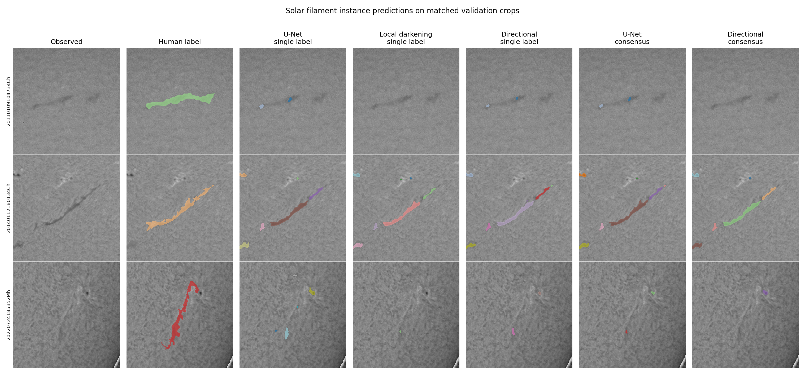
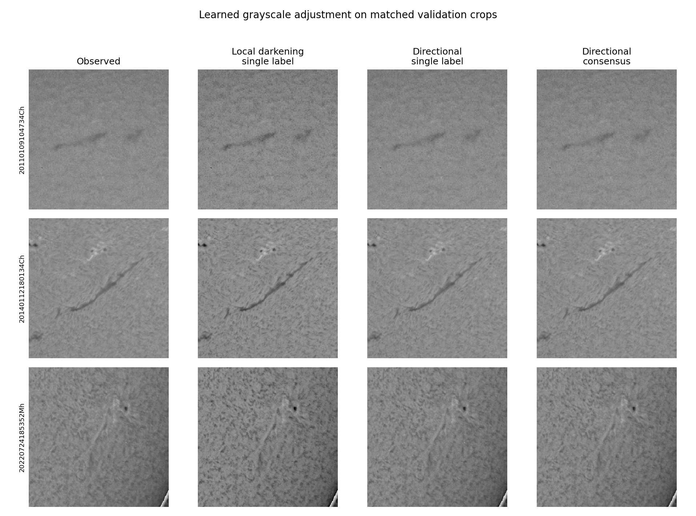

# Solar Filament Instance Segmentation

This CS 1675 project studies how to recover individual solar filaments in full-disk H-alpha images. Several dark structures that annotators traced were missed by our original U-Net. We tested whether an input adjustment that emphasizes faint dark lines helped the network find them, and whether it helped to train on more than one annotation of the same observation. The code in [baseline.py](baseline.py) implements all five configurations in our current study. The results below compare five models trained on the same 500 images and evaluated on the same 102 observations.

## Images and annotations

The labeled data contain 707 grayscale GONG observations at 2048 × 2048 pixels and 1,154 MAGFiLO annotation records. Each observation has one to three records containing instance polygons. We keep observations from the same calendar month together, giving 500 training, 102 validation and 105 held-out images. The 180 images supplied without public labels are separate. The validation set has 159 annotation records. [MAGFiLO data paper](https://doi.org/10.1038/s41597-024-03876-y)

## Model and experiments

The four-level U-Net has a base width of 16 and 1,963,809 parameters. Its decoder combines upsampled features with the corresponding encoder features. We compare three ways to form the network input. With `baseline`, the network reads normalized grayscale intensity. With `dark`, it subtracts a learned fraction of the deficit below the valid-pixel mean in a 31 × 31 neighborhood. With `direction`, this adjustment is weighted by a fixed four-orientation filter that compares a dark line with its two flanks. The two enhancements each add one shared gain, initialized to zero and constrained to [0, 2]. Both still feed a single-channel image to the network. [U-Net](https://lmb.informatik.uni-freiburg.de/people/ronneber/u-net/)

With `--labels first`, an image's target is the foreground union of its first record in string-sorted ID order. With `--labels consensus`, we form that union separately for every record and average the masks pixel by pixel. Two votes in three produce a target of 2/3. All configurations use the first record for foreground-biased crop selection, carry out the same geometric augmentation and draw one 512 × 512 patch per image per epoch. At inference the model reads only the image. Full-size probability maps are assembled from tiles, thresholded at 0.5 and split into eight-connected components of at least 32 pixels.

| Run directory | Input | Training labels |
| --- | --- | --- |
| v1.0-base | Raw grayscale | First |
| v1.1-dark | Local darkening | First |
| v1.2-line | Direction-weighted darkening | First |
| v1.2-vote | Raw grayscale | Consensus |
| v1.2-both | Direction-weighted darkening | Consensus |

Comparing v1.2-line with v1.1-dark isolates the fixed direction weighting under first-record supervision. Comparing v1.2-vote with v1.0-base, or v1.2-both with v1.2-line, isolates the training target for a fixed input. All arms use eight epochs, batch size 2, AdamW with learning rate 0.001, and BCE-with-logits plus soft Dice loss. We validate every two epochs and select the best checkpoint by local validation PQ, breaking ties with Dice. Each prediction is compared with each record independently, and scores are averaged first over records for an image, then over images. Instance diagnostics also report recall, precision and false positives for strict IoU > 0.50 and exploratory IoU ≥ 0.10. The five-arm comparison uses only the 102 validation images.

## Validation results

All five configurations completed eight training epochs. Each row uses its own validation-selected checkpoint and the same threshold of 0.5. Recall uses one-to-one instance matches with IoU greater than 0.50. The validation set contains 102 images, 159 annotation records and 1,161 marked instances across those records.

| Input and training target | Selected epoch | Local PQ ↑ | Mask Dice ↑ | Mask IoU ↑ | Strict recall ↑ | False positives per image ↓ |
| --- | ---: | ---: | ---: | ---: | ---: | ---: |
| Raw image, first record | 8 | 0.1000 | 0.5280 | 0.3724 | 30.40% | 18.73 |
| Local darkening, first record | 8 | 0.0867 | 0.4733 | 0.3265 | 20.76% | 12.42 |
| Directional darkening, first record | 8 | 0.1084 | 0.5265 | 0.3724 | 30.92% | 16.36 |
| **Raw image, consensus** | 8 | **0.1287** | 0.5204 | 0.3682 | 31.87% | 12.73 |
| Directional darkening, consensus | 8 | 0.1191 | 0.5111 | 0.3606 | 28.17% | 12.92 |

**Raw image, consensus** achieved the highest local PQ, 0.1287 versus 0.1000 for the raw-image control. At the same operating point it matched 370 annotated instances versus 353 and produced 12.73 false positives per image versus 18.73. Across the individual annotation records, the two models shared 307 matches. The selected model gained 63 and lost 46.



Each row shows the same region across models. The observations are the first, middle and last filenames in the sorted validation set. Each crop is centered on the largest filament in the first annotation record. Instance colors distinguish regions within each panel.



These input comparisons use the learned gain from each saved checkpoint and a common grayscale range. We plan to examine missed and fragmented filaments and evaluate the selected model on the 105 held-out observations.

### Earlier baseline

The original raw-image baseline selected epoch 6. Its validation PQ, Dice and IoU were 0.0743, 0.3062 and 0.1945. On the 105 held-out images it scored 0.0591, 0.3183 and 0.2051. [Archived baseline results and figures](https://github.com/Serenin0x/solar-filament-study/tree/b9adfd73d5d9c28fb52e11ac37414f60bde2cc72)

## Running the code

The current study ran on one RTX 5090 with PyTorch 2.8.0+cu128, NumPy 2.3.2, Pillow 11.3.0, pycocotools 2.0.11, SciPy 1.16.3 and Matplotlib 3.10.5. On a compatible Linux CUDA machine, the commands below install the recorded environment and check the three model inputs. Full training uses one NVIDIA GPU. The smoke checks, saved-checkpoint evaluation and visualization can also run on CPU. [PyTorch installation options](https://pytorch.org/get-started/previous-versions/)

The archived baseline figures and scores were produced in an environment with PyTorch 2.10.0+cu128 and NumPy 2.0.2. Pillow, pycocotools and SciPy had the same versions listed above. The original Matplotlib version was not recorded. Reproductions on different hardware and software can yield different scores.

```sh
python -m pip install torch==2.8.0 --index-url https://download.pytorch.org/whl/cu128
python -m pip install -r requirements.txt
python baseline.py smoke --variant baseline
python baseline.py smoke --variant dark
python baseline.py smoke --variant direction
```

Use the extracted distribution containing `train/train_images/` and `train/MAGFiLO_1.0_Annotations_kaggle2026_train.json`. The training annotation file used here has SHA-256 `5da9e92b5a1a1947fd5d57adb6688269625c48ec1ef884daf2a01618c9ed54a1`. Point `DATA` at that directory. Set `RUNS` to a separate, writable directory.

```sh
set -e
DATA=/path/to/data
RUNS=/path/to/runs
run_arm() {
  python baseline.py train --data "$DATA" --out "$RUNS/$1" \
    --variant "$2" --labels "$3" --workers 2 --epochs 8 --batch-size 2 \
    --patch 512 --width 16 --lr 0.001 --seed 2026 --val-every 2 \
    --threshold 0.5 --min-area 32 --no-visualize
  python baseline.py evaluate --data "$DATA" --out "$RUNS/$1" --split val
}
run_arm v1.2-both direction consensus
run_arm v1.0-base baseline first
run_arm v1.2-line direction first
run_arm v1.2-vote baseline consensus
run_arm v1.1-dark dark first
```

Each run writes the split, training history, an epoch recovery checkpoint (`last.pt`), the validation-selected weights (`baseline.pt`), and, after evaluation, `val-metrics.json` with per-record matches. To resume an interrupted run, repeat its training command with the same inputs, settings, source and output directory. To view a completed run, use the same data and checkpoint directory. The commands above defer figure generation until this step.

```sh
python baseline.py visualize --data "$DATA" --out "$RUNS/v1.2-both"
```

